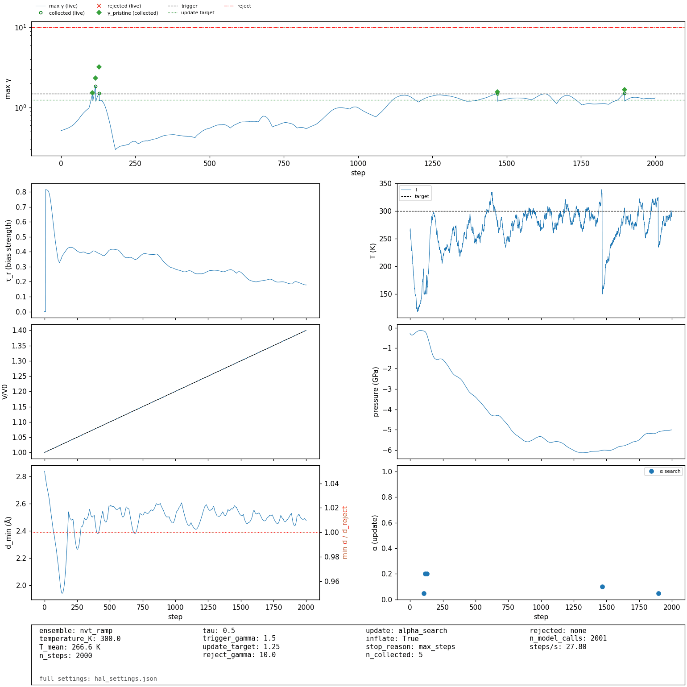
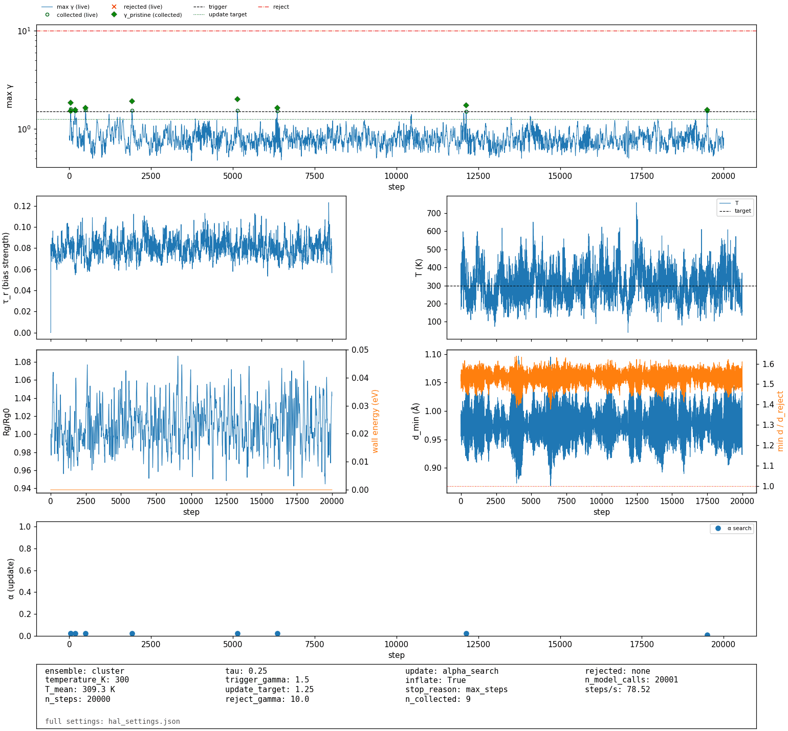

# UQ workflows: from extrapolation grade to new training data

A GRACE model can tell you where it does not know the answer. For every
atom it computes the **extrapolation grade γ** (CALM), which measures how far
the atom's environment is from the training data:

| γ | Meaning |
| :--- | :--- |
| γ ≤ 1 | inside the training distribution |
| γ ≈ 1 | at its boundary |
| γ ≫ 1 | extrapolation; the prediction is not trustworthy |

A structure is usually judged by its largest value, max γ. This page goes
through one full round of active learning: find the structures where γ is
high, compute them with DFT (or a teacher model), and add them to the training set. It works for
any GRACE model with a CALM artifact (`gmm_artifacts.npz`): fitted from
scratch, fine-tuned, or a foundation model. The method is described on the
[Uncertainty Quantification](uq.md) page and in
[arXiv:2609.40060](https://arxiv.org/abs/2609.40060); all options of the
`grace_uq` tool are listed there.

The steps:

0. Build the CALM artifact for your model.
1. Compute γ for single structures or a dataset (ASE).
2. Watch γ during normal MD in LAMMPS and keep the frames where it is high.
3. Or push the MD towards high γ on purpose (HAL), which finds new
   structures faster.
4. Select a small, diverse set of these structures.
5. Compute them with DFT (or a teacher model), add them to the training set,
   refit, and repeat.

Steps 2 and 3 are two ways to find candidates:

| Route | Use it when |
| :--- | :--- |
| Monitoring plain MD ([step 2](#2-md-in-lammps-monitor-and-collect-extrapolative-frames)) | You want the structures that your production simulation really visits. Cheap: no bias, fast Kokkos pair styles. |
| Biased MD, HAL ([step 3](#3-biased-dynamics-hal)) | Plain MD rarely leaves the training distribution, or you want many different extrapolative structures from a short run. |

Both routes work for periodic cells and for clusters and molecules.

## Before you start

The examples use two small GRACE-1L tutorial models from `examples/data/` in
the [repository](https://github.com/ICAMS/grace-tensorpotential):

- `AlLi-1L-small/`: Al-Li, fitted to 2938 periodic DFT structures;
- `ethanol-1L-small/`: one ethanol molecule (C<sub>2</sub>H<sub>6</sub>O),
  fitted to 800 configurations.

Each folder holds `model.yaml`, the checkpoint (`checkpoint.index` and
`checkpoint.data-00000-of-00001`; the tools take the prefix `checkpoint`),
the CALM artifact `gmm_artifacts.npz` and the training set `train.pkl.gz`.
They are demonstration models, stable in MD at 300–600 K, not production
potentials. Replace the paths and element names with your own.

Work in a folder `UQ` in the repository root, so that the output files stay
together:

```bash
mkdir -p UQ
cd UQ
```

All paths below are relative to this folder. All Al-Li examples use one
108-atom Al<sub>3</sub>Li cell (Al<sub>81</sub>Li<sub>27</sub>, the L1<sub>2</sub>
structure) from the training set, so the model knows it well. Save it in ASE
and LAMMPS format:

```python
import pandas as pd
from ase.io import write

# a 108-atom Al3Li supercell (Al81Li27) from the training set
df = pd.read_pickle("../examples/data/AlLi-1L-small/train.pkl.gz")
atoms = df["ase_atoms"].iloc[111]
write("Al3Li_108.extxyz", atoms)
write("Al3Li_108.lmp", atoms, format="lammps-data", specorder=["Al", "Li"], masses=True)
print(len(atoms), atoms.get_chemical_formula())
```

---

## 0. Build the CALM artifact for a fitted model

The artifact describes the training data in the model's own feature space.
Build it from the data the model was trained on:

```bash
grace_uq build --model-yaml ../examples/data/AlLi-1L-small/model.yaml \
               --checkpoint ../examples/data/AlLi-1L-small/checkpoint \
               --train-data ../examples/data/AlLi-1L-small/train.pkl.gz \
               --rp-dim 32 --n-clusters 1 \
               --artifact-path gmm_artifacts.npz
```

This takes about a minute on one GPU. It writes `gmm_artifacts.npz` and
`saved_model/`, a SavedModel that computes γ together with energies and
forces. ASE (`TPCalculator`) and the TensorFlow LAMMPS pair style `grace` load
this SavedModel. Check the artifact with `grace_uq info gmm_artifacts.npz`.

??? info "What the options mean, and what a good artifact looks like"
    `--rp-dim 32 --n-clusters 1` gives a small artifact: 34 feature
    dimensions (32 random projections plus two density channels) and one
    cluster per element. The tutorial artifacts in `examples/data/` were
    built with this command. For your own model, start with the defaults
    (128 random projections plus the density channels, the number of
    clusters chosen automatically between 1 and 16).

    In the `grace_uq info` output, the covariance rank of each cluster should
    be close to the feature dimension (33 of 34 here). Only a few percent of
    the training atoms should read γ > 1 (4.9 % of Al and 8.0 % of Li here).
    If many more do, see
    [Calibrating the threshold](uq.md#calibrating-the-threshold).
    All build options are listed under [`grace_uq build`](uq.md#grace_uq-build).

For the Kokkos LAMMPS pair styles (step 2), put the artifact into the `.npz`
weights file ([details](utilities.md#baking-in-uq-uncertainty-quantification-artifacts)):

```bash
grace_utils -p ../examples/data/AlLi-1L-small/model.yaml -c ../examples/data/AlLi-1L-small/checkpoint \
            export_kokkos -o grace_uq_kokkos.npz --uq-artifacts gmm_artifacts.npz
```

??? tip "You already have an artifact and only need the SavedModel"
    Leave out `--train-data` ([export-only mode](uq.md#export-only-mode));
    `--export-path` sets where the SavedModel goes:

    ```bash
    grace_uq build --model-yaml ../examples/data/AlLi-1L-small/model.yaml \
                   --checkpoint ../examples/data/AlLi-1L-small/checkpoint \
                   --artifact-path ../examples/data/AlLi-1L-small/gmm_artifacts.npz \
                   --export-path saved_model_export
    ```

!!! note "One artifact per set of weights"
    The artifact is valid only for the weights it was built with. Rebuild it
    after every refit or fine-tune. Foundation models with a **UQ** mark in
    the [foundation model tables](foundation.md) already ship one, in
    `~/.cache/grace/checkpoints/<MODEL>/` (from
    `grace_models checkpoint <MODEL>`).

---

## 1. Evaluate γ in ASE

Load the SavedModel with the normal calculator. It finds the UQ part and
returns γ, one value per atom, in `calc.results["gamma"]`:

```python
from ase.io import read
from tensorpotential.calculator import TPCalculator

atoms = read("Al3Li_108.extxyz")
atoms.rattle(0.02, seed=1)
calc = TPCalculator(model="saved_model")
atoms.calc = calc
atoms.get_potential_energy()
gamma = calc.results["gamma"]           # per-atom extrapolation grade, shape (n_atoms,)
print(gamma.shape, gamma.max(), (gamma > 1).sum())
```

**What you should see:** max γ = 0.53 and no atom above 1. This cell is well
inside the training data.

??? info "How γ reacts when the structure changes"
    Every atom of the undisplaced cell reads γ ≈ 0.52. Random displacements
    with a standard deviation of 0.1 Å (`atoms.rattle(0.1)`) keep max γ at
    0.66; 0.15 Å raise it to 1.25, and 0.2 Å to 3.5. Compressing the cell by
    10 % in each direction gives max γ = 2.0.

??? info "UQ modes: more outputs, or none"
    The default mode `"gamma_only"` returns γ and σ. `"full"` also returns
    `dsigma_dr` (the gradient of Σγ, used by HAL) and `virial_sigma`, at the
    cost of an extra backward pass. `disable_uq()` switches UQ off:

    ```python
    calc.enable_uq(mode="full")             # adds dsigma_dr / virial_sigma
    atoms.rattle(0.01, seed=2)
    atoms.get_potential_energy()
    print(sorted(calc.results))
    calc.disable_uq()                       # plain compute signature, no UQ outputs
    ```

    All result keys are listed under
    [Calculator Results](uq.md#calculator-results). To work from
    `model.yaml` + checkpoint + artifact instead of a SavedModel, use
    [`get_gmm_uq_calculator`](uq.md#loading-a-uq-enabled-calculator).

!!! warning "Non-periodic structures are changed in place"
    For a cluster or molecule (`pbc=False`), `TPCalculator` currently sets a
    cell, switches on `pbc` and shifts the positions of the `Atoms` object.
    Attach the calculator to a copy (`atoms.copy()`) if you need the original.

For a whole dataset (a pickled DataFrame with an `ase_atoms` column, an
extxyz file or a LAMMPS dump), use `grace_uq predict`: it writes energies,
forces, stresses and γ for every structure. [Step 4](#from-lammps)
shows it on the frames of a LAMMPS run.

---

## 2. MD in LAMMPS: monitor and collect extrapolative frames

Run your normal MD and let LAMMPS compute γ every few steps. The input below
writes a frame only when max γ is above γ<sub>min</sub> = 1.2, and stops the
run when max γ is above γ<sub>max</sub> = 10. It uses the Kokkos pair style
(GPU or CPU, no TensorFlow needed).

The run is at 1200 K, well above the 300–600 K where this model is used. At
a higher temperature the atoms move further from their equilibrium positions,
so the MD visits more of the configuration space and reaches structures that
the training data do not cover. For your own system, use the temperatures of
your production runs and some above them.

```
# in.monitor: gamma monitoring and collection with the Kokkos GRACE pair style
units           metal
atom_style      atomic
boundary        p p p
read_data       Al3Li_108.lmp

pair_style      grace/1l/kk                    # grace/2l/kk or grace/3l/kk for 2L/3L models
pair_coeff      * * grace_uq_kokkos.npz Al Li

# per-atom gamma, updated every 10 steps, and its maximum over all atoms
fix             grace_gamma all pair 10 grace/1l/kk gamma 1
compute         max_gamma all reduce max f_grace_gamma
variable        max_gamma equal c_max_gamma

thermo_style    custom step temp pe press c_max_gamma cpu cpuremain
thermo          100

# write a frame only if max(gamma) >= gamma_min
variable        gamma_min equal 1.2
variable        skip_frame equal "c_max_gamma < v_gamma_min"
dump            extrap all custom 10 extrapolative.dump id type element x y z f_grace_gamma
dump_modify     extrap skip v_skip_frame element Al Li

# stop the run once max(gamma) exceeds gamma_max
fix             stop all halt 10 v_max_gamma > 10.0 error continue

velocity        all create 1200 42 mom yes rot yes
fix             md all nvt temp 1200 1200 0.1
timestep        0.0005
run             4000
```

```bash
# GPU: LAMMPS built with Kokkos + CUDA, one GPU
lmp -k on g 1 -sf kk -pk kokkos newton on neigh half -in in.monitor

# CPU: LAMMPS built with Kokkos + OpenMP, 8 threads
lmp -k on t 8 -sf kk -pk kokkos newton on neigh half -in in.monitor
```

**What you should see:** at 1200 K the run writes 46 frames to
`extrapolative.dump`, from step 570 on, with max γ between 1.2 and 1.8. It
never reaches γ = 10, so it runs to the end. At 600 K the model stays inside
its training data (max γ below 0.9) and the dump stays empty.

??? info "Notes on this input"
    - `fix pair 10 ... gamma 1` asks for γ every 10 steps; the values are not
      updated in between. Use the same interval (or a multiple) for `thermo`,
      `dump` and `fix halt`, so that they always read a fresh value.
    - The `element` column in the dump tells the `grace_uq` tools the species.
    - `fix halt ... error continue` ends the `run` cleanly and goes on with the
      rest of the input script.
    - For a cluster or molecule, use `boundary f f f` and put it in a box with
      enough vacuum around it (for example `atoms.center(vacuum=10.0)` before
      writing the data file).
    - The Kokkos styles give `gamma`, `atomic_sigma` and `gmm_cluster`
      through `fix pair`, but no bias (for biased MD in LAMMPS see
      [HAL in LAMMPS](#in-lammps)).

??? tip "Using the TensorFlow pair style instead"
    The same input works with the TensorFlow pair style and the SavedModel.
    Change three lines, and run without the Kokkos switches
    (`lmp -in in.monitor`):

    ```
    pair_style      grace
    pair_coeff      * * saved_model Al Li
    fix             grace_gamma all pair 10 grace gamma 1
    ```

    γ is computed only on the steps where `fix pair` asks for it; all other
    steps cost the same as without UQ. Both pair styles agree on γ to within
    0.2 % and write the same 46 frames here.

**Choosing the thresholds.** γ<sub>min</sub> ≈ 1–1.5 keeps frames outside the
training data without filling the dump with frames at its boundary.
γ<sub>max</sub> ≈ 10 stops the run where it usually stops being physical
(atoms far too close, a collapsing or exploding cell); such frames are often
impossible to compute with DFT.

**Keep `extrapolative.dump`.** [Step 4](#from-lammps) selects from it
directly. Step 3 shows the second way to find candidates, biased MD;
do it as well, or go straight to step 4.

---

## 3. Biased dynamics (HAL)

This is the second way to find candidates. It does not need the output of
step 2. Plain MD with a good model often stays inside the training data for a long
time. **HAL** (hyperactive learning) adds a small extra force that pushes the
atoms towards higher γ. The walker (one biased MD run) collects every frame
where γ crosses a trigger, and then updates its own copy of the CALM model so
that the same region no longer counts as new. The walker is pushed on to new
structures.

The walker uses two CALM models ("towers"): the *live* tower, which drives
the bias and the trigger and is updated after every collected frame
(γ<sub>live</sub>), and the frozen training-set artifact (γ<sub>pristine</sub>).
The bias formula, the trigger, the rejection and the update are described under
[How the HAL driver works](uq.md#how-the-hal-driver-works).

The periodic examples start from the 108-atom cell `Al3Li_108.extxyz` of
[Before you start](#before-you-start) and run at 300 K for 2000 steps (1 ps).

### Command line

`grace_uq hal` runs one walker. The four periodic ensembles differ in what
the cell does: fixed (`nvt`), slowly expanded (`nvt_ramp`), free at 1 bar
(`npt`), or pushed towards high γ (`npt_stress`)
([ensembles](uq.md#hal-ensembles)):

```bash
MODEL="--model-dir ../examples/data/AlLi-1L-small"

grace_uq hal $MODEL --structure Al3Li_108.extxyz --ensemble nvt -T 300 --n-steps 2000 \
             --tau 0.5 --output-dir hal_nvt
grace_uq hal $MODEL --structure Al3Li_108.extxyz --ensemble nvt_ramp -T 300 --n-steps 2000 \
             --tau 0.5 --nvt-ramp 1.0 1.4 --output-dir hal_ramp
grace_uq hal $MODEL --structure Al3Li_108.extxyz --ensemble npt -T 300 --n-steps 2000 \
             --tau 0.5 --volume-guard 0.75 1.30 --output-dir hal_npt
grace_uq hal $MODEL --structure Al3Li_108.extxyz --ensemble npt_stress -T 300 --n-steps 2000 \
             --tau 0.5 --stress-tau 0.02 --bulk-modulus auto --output-dir hal_npt_stress
```

`--model-dir` finds `model.yaml`, the checkpoint and the artifact in one
folder. HAL needs `model.yaml` + checkpoint, not a SavedModel, because it
updates the live tower during the run. Each walker prints a status line
every 100 steps (`--progress-every`), for example at steps 1000 and 2000 of
`hal_npt`:

```text
step 1000/2000 | max γ 1.35 | collected 19 | rejected 1 | T 332 K | 25 steps/s
step 2000/2000 | max γ 1.27 | collected 23 | rejected 1 | T 279 K | 36 steps/s
```

steps/s is the average since the start, so it is low in the first lines,
while the model compiles.

**What you should see:** the four walkers collect about 3 (`nvt`), 5
(`nvt_ramp`), 23 (`npt`) and 25 (`npt_stress`) frames. On a GPU, two runs
with the same seed are not identical, so your counts will differ somewhat.
The collected frames are in `hal_collected.extxyz` in each output folder
([all output files](uq.md#output-files)).

Each walker also draws a diagnostics figure, `hal_diagnostics.png`. For the
`nvt_ramp` walker:



??? info "How to read the figure"
    The top panel shows max γ<sub>live</sub> over time, with circles for
    collected and crosses for rejected frames, and max γ<sub>pristine</sub>
    at the same steps (diamonds). After every collection max γ<sub>live</sub>
    drops to about 1.2 and then rises again under the bias. The other panels
    show the bias strength τ<sub>r</sub>, the temperature, the volume and
    pressure, the shortest distance between atoms and the update weight α.

    This walker collects 3 frames in the first 130 steps, then nothing until
    step 1468; the last two frames come at V/V<sub>0</sub> = 1.29 and 1.38.
    With one cluster per element, one update covers a long drift in the same
    direction ([why](uq.md#how-the-hal-driver-works)). Every panel is
    described under [Diagnostics figure](uq.md#diagnostics-figure).

**When most frames are rejected.** `hal_summary.json` gives the reason.
`gamma_pristine` means the walker went far from the training data; `gamma`
means its own live tower sees it beyond `--reject-gamma`. In both cases
lower `--tau` or `-T`, or start from a structure closer to the training data.

### Choosing τ {#choosing-tau}

τ is the most important setting, and the right value depends on the system:
the same τ can be too weak for one system and too strong for another.

1. Start at the default τ = 0.15 with a short walker.
2. If nothing is collected, raise τ in small steps (for example 0.2, 0.25,
   0.35, 0.5). A higher `-T` or the `nvt_ramp` ensemble also help.
3. Watch the diagnostics figure and the rejection counts. A good walker
   collects regularly and rejects little. If rejections dominate, or the
   structures fall apart, go back to a smaller τ.

To find a good τ quickly, run walkers with several τ values at the same
time: see the [τ scan](#tau-scan) under Many walkers.

??? info "Measured on the tutorial models"
    Collected / rejected frames, with the largest max γ<sub>live</sub> in
    brackets; 0 means nothing triggered. Al-Li: 300 K, 2000 steps; ethanol:
    300 K, 20000 steps.

    | τ | `nvt` | `nvt_ramp` | `npt` | `npt_stress` | ethanol, `cluster` |
    | :--- | :--- | :--- | :--- | :--- | :--- |
    | 0.15 (default) | 0 (max γ 0.74) | 0 (1.13) | 0 (0.91) | 0 (0.79) | 2 / 0 (1.57) |
    | 0.2 | | | | | 6 / 0 (1.55) |
    | 0.25 | 0 (0.89) | 0 (1.12) | 0 (0.92) | 0 (0.97) | 9 / 0 (1.61) |
    | 0.3 | | | | | 10 / 0 (1.85) |
    | 0.35 | 0 (1.32) | 0 (1.25) | 3 / 0 (1.50) | 2 / 0 (1.50) | |
    | 0.4 | | | 5 / 0 (1.93) | 6 / 0 (1.65) | |
    | 0.5 | 3 / 0 (1.76) | 5 / 0 (1.86) | 19 / 1 (2.79) | 26 / 0 (2.79) | |

    Al-Li is well trained and stable at 300 K: below τ = 0.35 no walker
    reaches the trigger in 2000 steps, and at τ = 0.5 every ensemble
    collects. The ethanol walker collects at every τ, and every collected
    frame holds one intact molecule. It runs away at τ = 0.5 (most triggers
    rejected, broken molecules), so keep a margin below that point. This
    page uses τ = 0.5 for Al-Li and τ = 0.25 for ethanol.

    Why the default τ collects little on a good model, and what τ means
    physically (an effective temperature, an outward shift in units of the
    thermal vibration), is explained under
    [What τ means](uq.md#what-tau-means).

### Many walkers {#many-walkers}

One walker on a DFT-sized cell uses only a small part of a GPU (a 108-atom
Al-Li walker: about 6 % of an RTX 3060 and 190 MiB). Run several at once with
`--repeats`. Here 8 walkers with the same settings start from 16 training cells:

```python
import pandas as pd
from ase.io import write

# starting structures for the walkers: the first 16 training cells with at least 100 atoms
df = pd.read_pickle("../examples/data/AlLi-1L-small/train.pkl.gz")
seeds = [a for a in df["ase_atoms"] if len(a) >= 100][:16]
write("seeds.extxyz", seeds)
print(len(seeds), seeds[1].get_chemical_formula())
```

```bash
grace_uq hal --model-dir ../examples/data/AlLi-1L-small --structure seeds.extxyz \
             --repeats 8 --walkers-per-gpu 8 \
             --ensemble nvt_ramp -T 300 --n-steps 2000 --tau 0.5 --output-dir walkers
```

Repeat r writes into `walkers/hal_w<r>/`, with its own seed and start
structure. `--walkers-per-gpu 8` runs all 8 at the same time on the GPU
(the default is 4; the others then wait for a free slot); a table of all
walkers goes to `walkers/walkers.csv`.

**What you should see:** the 8 walkers run at the same time on one RTX 3060
and finish in about 1.5 minutes. They collect 141 frames, 14–22 per walker,
and reject none.
How many walkers fit on one GPU, and the other details, are under
[Many walkers](uq.md#hal-many-walkers).

#### Scan τ with many walkers {#tau-scan}

`--ensemble`, `-T` and `--tau` can take several values with `--repeats`: then
K walkers run for **every combination**, all sharing the GPU. A τ scan uses
this: the walkers differ only in τ. `--repeats 2` runs two walkers for every
τ value, 8 in total, all at the same time on the GPU (`--walkers-per-gpu 8`):

```bash
grace_uq hal --model-dir ../examples/data/AlLi-1L-small --structure Al3Li_108.extxyz \
             --ensemble npt -T 300 --n-steps 2000 --tau 0.25 0.35 0.4 0.5 \
             --repeats 2 --walkers-per-gpu 8 --output-dir tau_scan
```

At the end the table is printed. Settings that are the same for all walkers
are listed in one line above it:

```text
same for all walkers: ensemble npt, temperature_K 300, start_frame 0, device 0
 walker  repeat  tau  collected     rejected stop_reason   mean_T_K  steps  steps_per_s     wall_s
      0       0 0.25          0            0   max_steps 256.540240   2001    23.299649  93.577345
      1       1 0.25          0            0   max_steps 264.769073   2001    23.167267  94.182373
      2       0 0.35          1            0   max_steps 261.018742   2001    23.174793  94.385165
      3       1 0.35          2            0   max_steps 269.834115   2001    22.948658  94.990900
      4       0 0.40          5            0   max_steps 268.003321   2001    22.873091  95.196329
      5       1 0.40          9            0   max_steps 273.855380   2001    22.810330  95.399171
      6       0 0.50         20 short_bond=1   max_steps 313.569721   2001    21.743623  99.608464
      7       1 0.50         26            0   max_steps 326.674918   2001    21.519415 100.615622
```

**What you should see:** nothing is collected at τ = 0.25, a few frames at
0.35 and 0.4, and many at 0.5, sometimes with a trigger rejected because two
atoms came too close (`short_bond`). The two walkers of one τ collect
different numbers: compare τ values by the trend, not by single counts. The 8
walkers finish in under 2 minutes on one RTX 3060. Each τ has its own
folder, `tau_scan/tau_0.25/hal_w0/` and so on, and `tau_scan/walkers.csv`
holds the table with every setting, plus the largest γ<sub>live</sub> and
γ<sub>pristine</sub> of each walker.

Several ensembles and temperatures work the same way, for example
`--ensemble nvt npt --tau 0.35 0.5` gives the folders `nvt_tau_0.35/`,
`npt_tau_0.5/` and so on ([grid over ensemble, temperature and τ](uq.md#hal-walker-grid)).
Without `--repeats`, several `--tau` values run one walker per τ, the same
as `--repeats 1` (`scan_tau` in Python).

??? example "Running walkers from a SLURM job script"
    The launcher runs on one machine. To spread walkers over several nodes, a
    job script can start them itself, M per GPU, in the background. This
    SLURM array runs 16 walkers, 4 on the GPU of each of its 4 tasks:

    ```bash
    #!/bin/bash
    #SBATCH --job-name=hal
    #SBATCH --array=0-3
    #SBATCH --gres=gpu:1
    #SBATCH --cpus-per-task=8
    #SBATCH --time=04:00:00
    #SBATCH --output=hal_%a.log

    M=4                                       # walkers sharing the GPU of this task
    export TF_FORCE_GPU_ALLOW_GROWTH=true     # each walker allocates only the GPU memory it needs
    export OMP_NUM_THREADS=$((SLURM_CPUS_PER_TASK / M))
    export TF_NUM_INTRAOP_THREADS=$((SLURM_CPUS_PER_TASK / M)) TF_NUM_INTEROP_THREADS=1

    for k in $(seq 0 $((M - 1))); do
      i=$((SLURM_ARRAY_TASK_ID * M + k))      # walker index: seed, start frame, output directory
      grace_uq hal --model-dir ../examples/data/AlLi-1L-small \
                   --structure seeds.extxyz --structure-index $i \
                   --ensemble nvt_ramp -T 300 --n-steps 2000 --tau 0.5 \
                   --seed $i --walker-id $i --output-dir walkers_slurm/hal_w$i > walker_$i.log 2>&1 &
    done
    wait
    ```

    `TF_FORCE_GPU_ALLOW_GROWTH` matters: without it, every TensorFlow process
    reserves most of the GPU memory at start-up, and little is left for the
    next walker. SLURM sets `CUDA_VISIBLE_DEVICES` for each task.

### Clusters and molecules

Clusters and molecules (no cell, `pbc=False`) use `--ensemble cluster`. It
adds a soft wall that keeps atoms from flying away
([details](uq.md#hal-containment-wall)). This example runs HAL on one
ethanol molecule from the training set (max γ = 0.85):

```python
import pandas as pd
from ase.io import write

# one ethanol molecule from the training set: 9 atoms, no cell, pbc=False
df = pd.read_pickle("../examples/data/ethanol-1L-small/train.pkl.gz")
atoms = df["ase_atoms"].iloc[0]
write("ethanol.extxyz", atoms)
print(len(atoms), atoms.get_chemical_formula(), atoms.pbc, atoms.cell.rank)
```

```bash
grace_uq hal --model-dir ../examples/data/ethanol-1L-small \
             --structure ethanol.extxyz --ensemble cluster -T 300 --n-steps 20000 --tau 0.25 \
             --output-dir ethanol_hal
```

The time step is 0.5 fs because of H, so 20000 steps are 10 ps.

**What you should see:** 6–9 collected frames, no rejections, and every
frame one intact molecule (`n_fragmented` 0 in `hal_summary.json`). For
clusters, the figure shows the radius of gyration and the wall energy
instead of the volume and pressure. Here the molecule keeps its shape and
never touches the wall:



??? example "The same walker in Python"
    ```python
    import numpy as np
    from ase.io import read
    from tensorpotential.uq.hal import run_hal

    atoms = read("ethanol.extxyz")          # pbc=False, no cell
    res = run_hal(
        atoms,
        model_dir="../examples/data/ethanol-1L-small",
        ensemble="cluster",
        temperature_K=300,
        n_steps=20000,
        tau=0.25,                            # see "Choosing tau"
        output_dir="ethanol_hal_py",
    )
    s, h = res.summary, res.history
    print(s["stop_reason"], s["n_collected"], s["rejected"], "fragmented:", s["n_fragmented"])
    print("wall radius", round(s["settings"]["cluster_wall_radius"], 2), "A")
    print("Rg/Rg0 min/max", np.nanmin(h["rg_ratio"]).round(3), np.nanmax(h["rg_ratio"]).round(3),
          " max wall energy", np.nanmax(h["wall_energy"]).round(4), "eV")
    ```

    This run collected 9 frames (`max_steps 9 {} fragmented: 0`). The wall
    radius is 4.1 Å; Rg/Rg<sub>0</sub> stays between 0.94 and 1.09 and the
    wall energy is zero throughout.

The collected frames go to DFT through the selection of
[step 4](#from-hal-walkers).

**An extrapolative start is fine.** When the starting structure itself has
max γ above `--trigger-gamma`, HAL collects it at step 0 as the first
candidate, updates the live tower and goes on. For example,
`Al3Li_108.extxyz` compressed by 10 % (max γ = 1.97) is collected at step 0,
and the walker collects again at step 38.

### Python

Everything above also runs from Python; these blocks are optional.

??? example "One walker with `run_hal`"
    `run_hal` runs one walker from Python, with the same options as the command
    line:

    ```python
    from ase.io import read
    from tensorpotential.uq.hal import run_hal

    atoms = read("Al3Li_108.extxyz")
    res = run_hal(
        atoms,
        model_dir="../examples/data/AlLi-1L-small",   # model.yaml, checkpoint, gmm_artifacts.npz
        ensemble="nvt_ramp",
        temperature_K=300,
        n_steps=2000,
        tau=0.5,                                   # see "Choosing tau"
        output_dir="hal_py",
    )
    print(res.summary["stop_reason"], res.summary["n_collected"], res.summary["rejected"])
    frames = res.frames          # collected ase.Atoms, also in hal_py/hal_collected.extxyz
    live = res.live_model        # the updated live CALM model (GMMUQModel)
    ```

    **What you should see:** `max_steps 5 {}`: the walker ran all steps,
    collected 5 frames and rejected none. The keyword names are listed under
    [HAL options](uq.md#hal-options).

??? example "Build a walker by hand, with your own integrator"
    `HALCalculator` wraps a UQ calculator and adds the bias and the ZBL
    guard; `HALCollector` is an ASE observer that triggers, rejects, writes
    frames and updates the live tower:

    ```python
    import numpy as np
    from ase import units
    from ase.io import read
    from ase.md.langevin import Langevin
    from ase.md.velocitydistribution import MaxwellBoltzmannDistribution, Stationary

    from tensorpotential.uq import GMMUQModel
    from tensorpotential.uq.factories import get_gmm_uq_calculator
    from tensorpotential.uq.hal import HALCalculator, HALCollector, HALStop, plot_diagnostics

    artifact = "../examples/data/AlLi-1L-small/gmm_artifacts.npz"
    base = get_gmm_uq_calculator(
        model_yaml="../examples/data/AlLi-1L-small/model.yaml",
        checkpoint="../examples/data/AlLi-1L-small/checkpoint",
        gmm_artifact_path=artifact,             # start of the live tower
        compute_dsigma_dr=True,
    )
    atoms = read("Al3Li_108.extxyz")
    element_indices = np.array([base.element_map[s] for s in atoms.get_chemical_symbols()])

    pristine = GMMUQModel(artifact)             # frozen tower; its file hash goes into hal_features.npz
    base.gmm_uq_model.reinvert_all()            # as run_hal: both towers re-inverted in float64
    pristine.reinvert_all()

    calc = HALCalculator(base, tau=0.5, tau_ema=10, zbl="auto")
    collector = HALCollector(
        atoms, calc,
        pristine=pristine,
        element_indices=element_indices,
        output_dir="hal_manual",
        trigger_gamma=1.5, update_target=1.25,
        temperature_K=300,                      # target, for the update-work floor
    )
    atoms.calc = calc
    rng = np.random.default_rng(42)
    MaxwellBoltzmannDistribution(atoms, temperature_K=300, rng=rng)
    Stationary(atoms, preserve_temperature=False)  # zero total momentum at the start
    dyn = Langevin(atoms, 0.5 * units.fs, temperature_K=300, friction=0.01 / units.fs,
                   fixcm=False, rng=rng)
    dyn.attach(Stationary, 1, atoms, preserve_temperature=False)  # COM reset every step
    dyn.attach(collector, interval=1)
    try:
        dyn.run(2000)
        reason = "max_steps"
    except HALStop as stop:
        reason = stop.reason
    summary = collector.finalize(reason)
    plot_diagnostics(collector.history.as_dict(), summary, "hal_manual/hal_diagnostics.png")
    print(summary["n_collected"], summary["rejected"])
    ```

    This is the walker that `run_hal(..., ensemble="nvt", tau=0.5)` runs; it
    collects 3 frames and rejects none. Attach the collector with
    `interval=1`: it reads the results of every step and keeps the history.
    `collector.finalize` writes `hal_history.npz`, `hal_live_artifacts.npz`
    and `hal_summary.json`.

### Chaining walkers

Walkers are independent: each starts its live tower from the training-set
artifact. To continue where an earlier walker stopped, start from that
walker's live artifact:

```bash
grace_uq hal $MODEL --live-start-artifact-path hal_ramp/hal_live_artifacts.npz \
             --structure Al3Li_108.extxyz --ensemble nvt -T 300 --n-steps 2000 \
             --tau 0.5 --seed 1 --walker-id 1 --output-dir hal_nvt_1
```

**What you should see:** this walker collects nothing (max γ<sub>live</sub>
0.76), because the structures it visits are already covered by `hal_ramp`.
Started from the training-set artifact instead, it collects 6 frames.

### In LAMMPS {#in-lammps}

LAMMPS can run biased MD too, with the TensorFlow pair style `grace` and the
SavedModel. The `tau` keyword adds the same bias as `grace_uq hal`, but
LAMMPS does not update the CALM model during the run. Run it on one MPI rank:

```
# in.hal: uncertainty-biased (HAL) MD with the TensorFlow GRACE pair style; single MPI rank
units           metal
atom_style      atomic
boundary        p p p
read_data       Al3Li_108.lmp

# GRACE with the force bias tau, plus a ZBL guard against too-close pairs
pair_style      hybrid/overlay grace tau 0.5 zbl 1.3 1.8
pair_coeff      * * grace saved_model Al Li
pair_coeff      1 1 zbl 13 13
pair_coeff      1 2 zbl 13 3
pair_coeff      2 2 zbl 3 3

# gamma and the uncertainty force (gradient of sum gamma) every 10 steps
fix             grace_gamma all pair 10 grace gamma 1
fix             grace_uf all pair 10 grace uncertainty_force 1
compute         max_gamma all reduce max f_grace_gamma
variable        max_gamma equal c_max_gamma
variable        ufmag atom sqrt(f_grace_uf[1]^2+f_grace_uf[2]^2+f_grace_uf[3]^2)
compute         max_uf all reduce max v_ufmag

thermo_style    custom step temp pe press fmax c_max_uf c_max_gamma
thermo          100

variable        gamma_min equal 1.5
variable        skip_frame equal "c_max_gamma < v_gamma_min"
dump            hal all custom 10 hal_candidates.dump id type element x y z f_grace_gamma
dump_modify     hal skip v_skip_frame element Al Li

fix             stop all halt 10 v_max_gamma > 10.0 error continue

velocity        all create 300 42 mom yes rot yes
fix             nve all nve
fix             thermostat all langevin 300 300 0.1 42 zero yes
timestep        0.0005
run             2000
```

```bash
# GPU: TensorFlow uses the first visible GPU
lmp -in in.hal

# CPU: hide the GPUs from TensorFlow, 8 threads
CUDA_VISIBLE_DEVICES="" OMP_NUM_THREADS=8 TF_NUM_INTRAOP_THREADS=8 TF_NUM_INTEROP_THREADS=1 \
    lmp -in in.hal
```

On the CPU, TensorFlow prints a `failed call to cuInit` line at start; it is
harmless.

**What you should see:** max γ rises to about 4.7 within 100 steps and then
mostly stays between 3.6 and 7. The run dumps 188 frames from step 70 on, so
filter them with [step 4](#from-lammps). With `tau 0.15` max γ stays below
0.75 and nothing is dumped.

??? example "NPT with the stress bias"
    `stress_tau` adds the stress bias of `npt_stress`, which also pushes the
    cell towards higher γ. `bulk_modulus` (GPa) sets its scale:

    ```
    # in.hal_npt: HAL MD with force and stress bias at 1 bar; single MPI rank
    units           metal
    atom_style      atomic
    boundary        p p p
    read_data       Al3Li_108.lmp

    # bulk_modulus in GPa (here: the model's estimate for this cell)
    pair_style      hybrid/overlay grace tau 0.4 stress_tau 0.02 bulk_modulus 65 zbl 1.3 1.8
    pair_coeff      * * grace saved_model Al Li
    pair_coeff      1 1 zbl 13 13
    pair_coeff      1 2 zbl 13 3
    pair_coeff      2 2 zbl 3 3

    fix             grace_gamma all pair 10 grace gamma 1
    compute         max_gamma all reduce max f_grace_gamma
    variable        max_gamma equal c_max_gamma

    thermo_style    custom step temp pe press vol c_max_gamma
    thermo          100

    variable        gamma_min equal 1.5
    variable        skip_frame equal "c_max_gamma < v_gamma_min"
    dump            hal all custom 10 hal_npt_candidates.dump id type element x y z f_grace_gamma
    dump_modify     hal skip v_skip_frame element Al Li

    fix             stop all halt 10 v_max_gamma > 10.0 error continue

    velocity        all create 300 42 mom yes rot yes
    fix             md all npt temp 300 300 0.1 iso 1.0 1.0 1.0
    timestep        0.0005
    run             2000
    ```

    ```bash
    # GPU: TensorFlow uses the first visible GPU
    lmp -in in.hal_npt

    # CPU: hide the GPUs from TensorFlow, 8 threads
    CUDA_VISIBLE_DEVICES="" OMP_NUM_THREADS=8 TF_NUM_INTRAOP_THREADS=8 TF_NUM_INTEROP_THREADS=1 \
        lmp -in in.hal_npt
    ```

    This run dumps 116 frames from step 770 on, with max γ between 1.5 and
    4.4; with `tau 0.15` it dumps nothing. The bulk modulus is the model's
    own estimate for this cell, 65.2 GPa:

    ```python
    from ase import units
    from ase.io import read
    from tensorpotential.calculator import TPCalculator
    from tensorpotential.uq.hal import estimate_bulk_modulus

    atoms = read("Al3Li_108.extxyz")
    b = estimate_bulk_modulus(atoms, TPCalculator(model="saved_model"))
    print("B", b, "eV/A^3 =", b / units.GPa, "GPa")
    ```

The other keywords, how they map to `grace_uq hal`, and the limits of HAL in
LAMMPS are listed under
[HAL in LAMMPS: options and limits](uq.md#hal-in-lammps-options-and-limits).

!!! note "LAMMPS version"
    The `tau`, `tau_norm`, `tau_group`, `stress_tau` and `bulk_modulus`
    keywords are part of the `grace` branch of the GRACE LAMMPS sources
    (lammps-ace); the inputs above were run with a build of that branch.

---

## 4. Select structures for DFT

Steps 2 and 3 give many frames, and many of them are almost the same:
neighbouring frames of one MD run or one walker differ only a little.
`grace_uq select` picks a small set that covers them all.

The default strategy `calm-greedy` picks the most extrapolative frame first.
After each pick it updates a copy of the CALM model, so frames similar to an
earlier pick no longer look new and are passed over. It stops by itself when
no remaining frame has γ above 1: this is the *natural set*. Use `-n` to set
an upper limit, for example `-n 10` for a budget of 10 DFT calculations.
If the natural set is larger, `select` stops at the limit and the summary
says that the pool is not covered yet; if it is smaller, `select` stops at
the natural set. Always select
against the **training-set** artifact, not a walker's live one.

### From the LAMMPS run (step 2) {#from-lammps}

`select --dataset` reads the LAMMPS dump directly (also an extxyz file or a
pickled DataFrame). With the model it first computes γ:

```bash
grace_uq select --dataset extrapolative.dump \
    --model-dir ../examples/data/AlLi-1L-small \
    --output lammps_for_dft.pkl.gz
```

The species come from the dump's `element` column; for a dump without it,
give one element per atom type, type 1 first (`--dump-elements Al Li`).

**What you should see:** from the 46 frames of the step 2 run, a natural set
of 14 frames, with max γ falling from 1.77 to 1.01.

??? tip "Predict once, select several times"
    For a large pool, predict once with `grace_uq predict` and select from
    the prediction as often as you like. `--features-gamma-min 1.0` keeps the
    features of the atoms with γ ≥ 1, which `select` needs:

    ```bash
    grace_uq predict --model ../examples/data/AlLi-1L-small/model.yaml \
        --checkpoint ../examples/data/AlLi-1L-small/checkpoint \
        --artifact ../examples/data/AlLi-1L-small/gmm_artifacts.npz \
        --dataset extrapolative.dump --features-gamma-min 1.0 \
        --output lammps_pred.pkl.gz
    grace_uq select --predicted lammps_pred.pkl.gz \
        --artifact ../examples/data/AlLi-1L-small/gmm_artifacts.npz \
        --output lammps_for_dft.extxyz
    ```

    This gives the same 14 frames. With a SavedModel, pass
    `--model saved_model_export --uq ../examples/data/AlLi-1L-small/gmm_artifacts.npz`
    to `select`, or the artifact as `--artifact` to `predict`. All options are listed
    under [`grace_uq predict`](uq.md#grace_uq-predict); from Python, use
    [`predict_structures`](utilities.md#python-api-predict_structures).

### From HAL walkers (step 3) {#from-hal-walkers}

Each walker saved the features of its collected frames, so `--hal-dirs` needs
no model, no prediction and no GPU. Give it all walker folders of step 3 at
once:

```bash
grace_uq select --hal-dirs hal_*/ \
    --artifact ../examples/data/AlLi-1L-small/gmm_artifacts.npz \
    --strategy calm-greedy random-all:5 \
    --output selected_for_dft.extxyz
```

`random-all:5` adds 5 random frames from those that `calm-greedy` did not
pick, useful for validation. `--model-dir ../examples/data/AlLi-1L-small` can
replace `--artifact`.

**What you should see:** the `hal_*` folders of step 3 (the four
command-line walkers and `hal_nvt_1`, plus `hal_py` and `hal_manual` if you
ran the optional Python examples) hold 64 frames with all of them;
`hal_nvt_1`, which collected nothing, is skipped with a warning.
`calm-greedy` picks 36 of them and `random-all` 5 more:

```text
  strategy parts (in order, each on the frames not yet picked): calm-greedy 36 (natural set) | random-all 5/5
```

The [many walkers](#many-walkers) and the [ethanol walker](#clusters-and-molecules)
of step 3 are selected the same way, with their own folders and model. For
ethanol, `select` keeps every collected frame, because each one adds
something the others do not cover:

```bash
grace_uq select --hal-dirs ethanol_hal \
    --artifact ../examples/data/ethanol-1L-small/gmm_artifacts.npz \
    --output ethanol_for_dft.extxyz
```

### Other strategies

| `--strategy` | Picks |
| :--- | :--- |
| `calm-greedy` (default) | the most extrapolative frames, skipping similar ones; stops at the natural set |
| `fps-extrap` | frames spread evenly over the extrapolative atoms (farthest-point sampling); needs `-n` |
| `random-extrap` | random frames with at least one atom with γ > 1; needs `-n` |
| `random-all` | random frames of the whole pool; needs `-n` |
| `fps-all` | frames spread evenly over all atoms; needs `-n` |

!!! tip "Combine strategies"
    Several strategies can be combined, for example
    `--strategy calm-greedy fps-extrap:10 random-all:5`; each part picks from
    the frames the earlier parts left.

How the strategies compare, the per-element floors, pool files and timing for
large pools are under [Selection strategies](uq.md#selection-strategies).

---

## 5. Label, upfit and rebuild

1. Compute the selected structures with DFT and collect them into a training
   DataFrame (for VASP, see [`grace_collect`](utilities.md#grace_collect)).
   Or label them with a teacher model, for example a foundation model.
2. Add them to the training set and continue the fit from the current
   checkpoint ([restart from checkpoint](quickstart.md#restart-from-checkpoint),
   [fine-tuning foundation models](foundation.md#fine-tuning-foundation-models)).
3. Rebuild the CALM artifact from the extended training set with the same
   `grace_uq build` settings ([step 0](#0-build-the-calm-artifact-for-a-fitted-model)).
4. Explore again with the new model: LAMMPS monitoring, HAL, or both.

Stop when your production simulations stay at γ ≤ 1.
