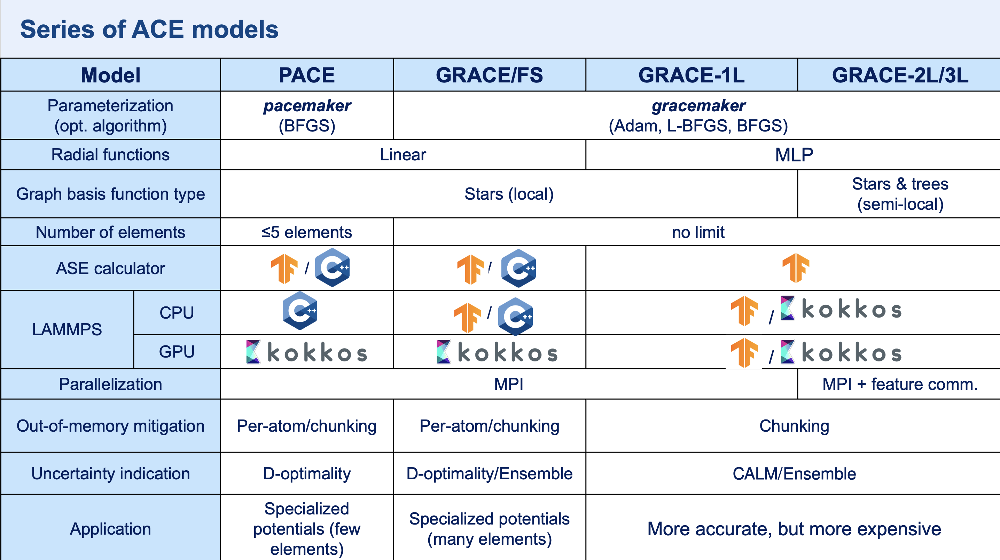

# gracemaker

`gracemaker` is a tool for fitting interatomic potentials in a general non-linear Graph Atomic Cluster Expansion (GRACE) form.

Project GRACEmaker is a heavily modified and in large parts rewritten version of the [PACEmaker](https://pacemaker.readthedocs.io/)
software geared towards support for multi-component materials and graph architectures.

## What's new

### [0.6.2](https://github.com/ICAMS/grace-tensorpotential/releases/tag/0.6.2) (October 2026)

- **[Uncertainty-driven exploration (HAL)](https://gracemaker.readthedocs.io/en/latest/gracemaker/uq_workflows/).** `grace_uq hal` runs molecular dynamics biased towards high uncertainty and collects the structures where the extrapolation grade γ is high, as new training data. Step by step: the [UQ workflows](https://gracemaker.readthedocs.io/en/latest/gracemaker/uq_workflows/) tutorial.

### [0.6.1](https://github.com/ICAMS/grace-tensorpotential/releases/tag/0.6.1) (3 September 2026)

- **[Foundation models re-exported](https://gracemaker.readthedocs.io/en/latest/gracemaker/utilities/#updating-cached-models).** The distributed models were rebuilt to fix a NaN in `virial_sigma` (the uncertainty contribution to the virial). Cached models now record where they were downloaded from, and the new `grace_models update` re-downloads only the copies that are out of date.
- **[Tunable uncertainty threshold](https://gracemaker.readthedocs.io/en/latest/gracemaker/uq/#calibrating-the-threshold).** `grace_uq build --threshold-percentile Q` puts γ = 1 at the Q-th percentile of the training distribution instead of the default robust outlier fence, for training sets where many atoms read γ > 1. `grace_uq info` reports which calibration was used.
- **[Bulk prediction](https://gracemaker.readthedocs.io/en/latest/gracemaker/utilities/#python-api-predict_structures).** A new `predict_structures` helper evaluates a whole list of structures with a single calculator instance; `grace_predict` and `grace_uq predict` now both use it.

### [0.6.0](https://github.com/ICAMS/grace-tensorpotential/releases/tag/0.6.0) (7 July 2026)

- **[Uncertainty estimates](https://gracemaker.readthedocs.io/en/latest/gracemaker/uq/).** Models can report a per-atom uncertainty score γ that flags extrapolation, for spotting unreliable predictions and for active learning. New command-line tool: `grace_uq`.
- **[LAMMPS Kokkos support](https://gracemaker.readthedocs.io/en/latest/gracemaker/quickstart/#lammps-kokkos-npz-grace-1l-grace-2l-grace-3l).** GRACE models can be exported for the fast Kokkos pair styles in LAMMPS, with the uncertainty score γ.
- **[Foundation models on HuggingFace](https://huggingface.co/AMS-ICAMS-RUB/grace-foundation-models).** The released models include uncertainty support out of the box.
- **[GRACE-3L-OMAT/OAM](https://gracemaker.readthedocs.io/en/latest/gracemaker/foundation/#three-layer-3l-models).** There are new, larger **3-layer models** (`GRACE-3L-OMAT-large` and `GRACE-3L-OMAT-large-ft-AM`).
- **[Faster and lighter by default](https://gracemaker.readthedocs.io/en/latest/gracemaker/foundation/).** Foundation models use fp32 by default: about half the memory and twice the speed. The fp64 versions have the suffix `-fp64`.
- **Better tooling.** `grace_dashboard` shows training curves and metrics in the browser; `grace_models` lists, inspects and downloads models (including Kokkos weights); a fit can save and resume in the middle of an epoch.

## Series of ACE models




## Features

* Support for multi-component material systems with unlimited number of interacting elements.
* Extension of the local ACE models to also include semi-local interactions (a.k.a. message passing).
* Line of models targeting various performance/complexity regimes and hardware:
    * **GRACE/FS**: Fast, mildly non-linear local model with standalone C++ implementation enabling
    efficient multi-CPU parallelization using MPI in LAMMPS. Intended for large-scale simulations of systems
    containing up to several million atoms.
   
    * **GRACE-1L**: Local, non-linear model with improved accuracy intended to run on GPU.
    Utilizes TensorFlow library to run simulations in LAMMPS or in python and supports multi-GPU parallelization.
    Suitable for modeling both small systems and large-scale simulations of hundreds of thousands of atoms.
  
    * **GRACE-2L**: Semi-local, non-linear model offering state-of-the-art accuracy. 
    Utilizes TensorFlow library to run simulations in LAMMPS or in python.
    Best applied for simulating molecular systems and materials with up to tens of thousands of atoms.

    * **GRACE-3L**: Semi-local, non-linear model with a third message-passing layer for a larger
    effective receptive field, offering the best accuracy of the series. Available as
    [foundation models](gracemaker/foundation.md#three-layer-3l-models) (natively fp32) for use in
    python or in LAMMPS, including the TensorFlow-free `grace/3l/kk` Kokkos pair style.

## What's next ?
* !!NEW!! [Video tutorial](https://www.youtube.com/watch?v=rndnkiu9LGE)
* [Installation](gracemaker/install.md)
* [Quick start](gracemaker/quickstart.md)
* [Tutorials](gracemaker/tutorials.md)
* [FAQ](gracemaker/faq.md)

## Documentation

Please use the navigation bar on the left to explore documentation

## License  

This code and the foundation models are distributed under the [Academic Software License](https://github.com/ICAMS/grace-tensorpotential/blob/master/LICENSE.md).  


## Citation

Please cite the following papers if you use GRACEmaker in your work:

- [Lysogorskiy, Y., Bochkarev, A. and Drautz, R. Graph atomic cluster expansion for foundational machine learning interatomic potentials. npj Computational Materials 12(1), 114 (2026)](https://www.nature.com/articles/s41524-026-01979-1)
- [Bochkarev, A., Lysogorskiy, Y. and Drautz, R. Graph Atomic Cluster Expansion for Semilocal Interactions beyond Equivariant Message Passing. Phys. Rev. X 14, 021036 (2024)](https://journals.aps.org/prx/abstract/10.1103/PhysRevX.14.021036)
- For the CALM uncertainty indication (extrapolation grade `gamma`): [Lysogorskiy, Y., Bochkarev, A. and Drautz, R. A latent-space extrapolation grade built into graph atomic cluster expansion foundation potentials. arXiv:2609.40060 (2026)](https://arxiv.org/abs/2609.40060)


<details>
<summary>BibTeX (click to expand)</summary>

```bibtex
@article{lysogorskiy2026calm,
  title={A latent-space extrapolation grade built into graph atomic cluster expansion foundation potentials},
  author={Lysogorskiy, Yury and Bochkarev, Anton and Drautz, Ralf},
  journal={arXiv preprint arXiv:2609.40060},
  year={2026},
  url={https://arxiv.org/abs/2609.40060}
}

@article{PhysRevX.14.021036,
  title = {Graph Atomic Cluster Expansion for Semilocal Interactions beyond Equivariant Message Passing},
  author = {Bochkarev, Anton and Lysogorskiy, Yury and Drautz, Ralf},
  journal = {Phys. Rev. X},
  volume = {14},
  issue = {2},
  pages = {021036},
  numpages = {28},
  year = {2024},
  month = {Jun},
  publisher = {American Physical Society},
  doi = {10.1103/PhysRevX.14.021036},
  url = {https://link.aps.org/doi/10.1103/PhysRevX.14.021036}
}

```
</details>
